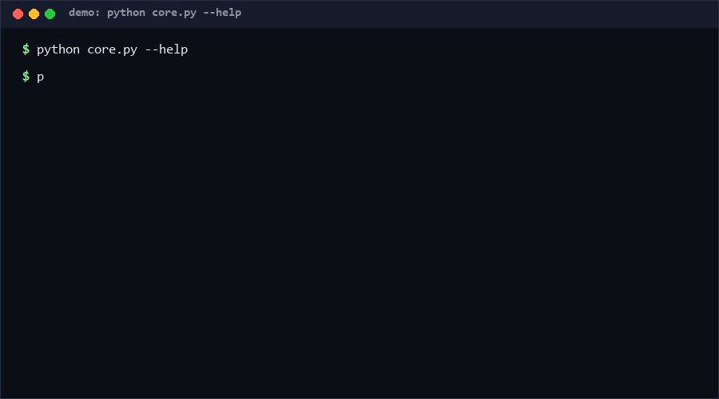

# money-precision-check

A static analyzer that flags the three classic ways Python code silently
corrupts money: constructing money-like values as floats (M1), rounding them
with binary-float `round()` (M2), and dividing or taking remainders of them
(M3). AST-based, pure standard library, offline, no configuration needed.
Confidence: high for the three rule classes on English-named variables;
the money-name heuristic is intentionally lexical.

as of 2026-10-11

<p align="center"></p>

## Problem

`0.1 + 0.2 != 0.3` is a curiosity for floats and a production incident for
money. The bug almost always enters through one of three doors: a price is
born as `0.0`, a total is `round()`-ed through binary floats, or a bill is
split with `/` and the lost remainder cents vanish. Reviewers miss these
because each line looks harmless. What is needed is a scanner that treats
"money-shaped names" as a precision hazard class.

## How it works

- Names containing `price/amount/cost/total/balance/fee/salary/payment/
  refund/commission/cents` (case-insensitive) are treated as money-like.
- **M1 (error)**: float literal or `float(...)` assigned to a money-like
  name — including tuple unpacking and annotated assignments.
- **M2 (warning)**: `round(money_var, ...)` — banker's rounding over binary
  floats; flagged as a warning because `Decimal` + explicit quantize is the
  fix.
- **M3 (error)**: money-like operand in `/`, `//`, or `%` — division loses
  remainder cents.
- `Decimal(...)` construction and integer-cent literals are *not* flagged.
- Exit codes: `0` clean or warnings only, `1` any error finding (or IO /
  PARSE errors), `--exit-zero` for report-only CI runs.

## Quickstart

```bash
python core.py src/                       # scan a tree (~fast; AST only)
python core.py billing.py --format text   # human-readable findings
python self_test.py                       # ~50 test cases (~3 s)
```

## Why not X

| Alternative | Stars (as of 2026-10-11) | How this differs |
| --- | --- | --- |
| [siddharthharbinger/08-currency-rounding-bug](https://github.com/siddharthharbinger/08-currency-rounding-bug) | 0 | Demonstrates one integer-split bug that drops remainder cents; this repo is a reusable scanner that finds such patterns in arbitrary code via AST rules. |
| [Vukhovanets/CurrencyRounding](https://github.com/Vukhovanets/CurrencyRounding) | 0 | A rounding implementation/sandbox; this repo audits *your* source instead of rounding values for you. |
| [aerapass/country-data](https://github.com/aerapass/country-data) | 3 | Reference data for country/currency metadata; complementary — this repo checks the arithmetic around those currencies, statically, with zero data files. |

Anchors found via search as of 2026-10-11; descriptions paraphrased.

## Minimal Fallback

No Python available for scanning? Two greps catch most M1/M2 hits:
`grep -rnE "(price|amount|cost|total|balance|fee)[a-z_]* *= *[0-9]+\.[0-9]+"`
and `grep -rnE "round\((price|amount|cost|total|balance|fee)"`. No AST, more
false positives/negatives, but zero setup.

## Design Trade-offs

- Name heuristics over type inference: zero-config and cross-project, at the
  cost of missing non-English variable names (e.g. `总价 = 0.0` is not
  flagged — a documented limitation).
- Warning for M2 rather than error: legitimate when the value is display-only.
- No autofix: silently rewriting money arithmetic is how the bug got in.

## Limits & Second-order Effects

- Lexical matching means both false negatives (`prix = 0.0`) and rare false
  positives (`total_seconds = 0.0` — actually a fine catch for code review).
- Python-only; Java/JS money bugs need their own scanner.
- Second-order effect: teams sometimes "fix" findings by renaming variables
  to dodge the hint list. Treat renamed-but-still-money fields as findings.

## FAQ

**Why not just require Decimal everywhere?**
You can lint for that too, but real codebases have display formatting and
interop layers where float is tolerated; this scanner grades the risk
instead of banning a type.

**When NOT to use this?**
Scientific/numeric code where "total" means totals of measurements, or
codebases that already enforce a currency type end-to-end at the language
level.

**Does it execute my code?**
Never. It parses AST only.

## Core Assumptions

- [A1] Variable names are the primary carrier of "moneyness" in reviewed
  codebases; where types carry it, this tool under-reports.
- [A2] Integer-cent representations are the intended safe pattern and are
  not flagged.
- [A3] Warnings (M2) may exist in healthy display code; errors (M1/M3)
  should be fixed before merge.

Confidence: rule logic high; hint-list coverage medium (lexical by nature).
All claims as of 2026-10-11.

---

Part of the [zhengming-toolbox](https://github.com/chenhz01/zhengming-toolbox) — 55 purpose-built AI-engineering tools across neglected niches.

Related tools: [unit-confusion-check](https://github.com/chenhz01/unit-confusion-check) · [log-redaction-spec](https://github.com/chenhz01/log-redaction-spec) · [secret-rotation-check](https://github.com/chenhz01/secret-rotation-check)
